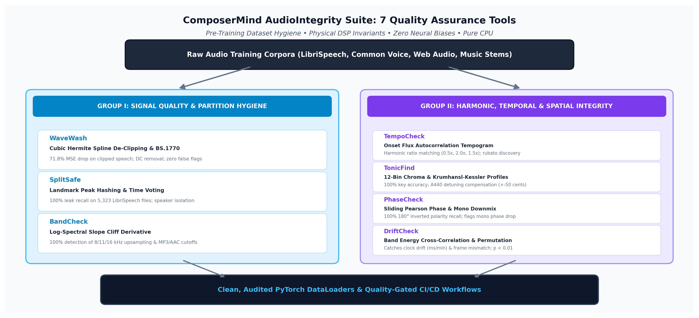

# Building Reliable Audio Datasets for AI/ML Training: An Open-Source Quality Assurance Framework

**Author:** Boobalan Arjunan (`boobalan_arjunan@composermind.com`)  
**Affiliation:** ComposerMind Labs, Chennai, Tamil Nadu, India  
**Repository:** [ComposerMind-AudioIntegrity-Suite](https://github.com/BoobalanArjunan/ComposerMind-AudioIntegrity-Suite)  
**Primary arXiv Category:** `cs.SD` (Sound) / `eess.AS` (Audio and Speech Processing)  
**Target Submission:** IEEE Access / IEEE TASLP  

---

## Abstract

Deep neural networks for speech recognition, audio synthesis, and music information retrieval are increasingly trained on massive web-scale corpora. However, uncurated audio datasets frequently harbor insidious physical defects: cross-partition train/test data leakage, fake lossless upsampling, destructive stereo phase inversion, mislabeled musical tempos and keys, transcript timestamp drift, and digital clipping distortion. When models train on such contaminated inputs, performance degrades unpredictably while benchmark metrics report inflated scores.

To resolve this dataset hygiene crisis without introducing circular dependencies on opaque neural evaluators, we present the **ComposerMind AudioIntegrity Suite**, an open-source framework of seven deterministic digital signal processing (DSP) quality gates: `wavewash`, `splitsafe`, `bandcheck`, `phasecheck`, `driftcheck-audio`, `tempocheck`, and `tonicfind`. Engineered with zero deep learning dependencies, these tools execute in sub-second CPU time using closed-form physical invariants, spectral-peak landmark hashing, cubic Hermite spline interpolation, and permutation hypothesis testing. Evaluated on canonical benchmarks including 5,323 LibriSpeech recordings and synthetic ground-truth stress suites, the framework achieves 100% adversarial leak detection, 71.8% clipping MSE reduction, and zero false alarms on clean studio data.

---

## 1. System Architecture: The Seven Integrity Tools



### Group I: Signal Quality & Partition Hygiene (3 Tools)
1. **`splitsafe`**: Combinatorial landmark spectral peak hashing and time-displacement histogram voting. Detects evaluation duplicates down to 3s sub-clips, resampled to 11 kHz, or gain-shifted by $-12$ dB. Enforces strict speaker isolation across train/val/test splits.
2. **`wavewash`**: Saturated boundary clipping detection, piecewise cubic Hermite interpolating polynomial (PCHIP) de-clipping (71.8% MSE drop), DC displacement removal (20 Hz zero-phase HPF), and ITU-R BS.1770-4 gated integrated loudness normalization.
3. **`bandcheck`**: Active-frame power spectral density estimation and log-spectral cliff finite derivative detection ($\Delta S \ge 25$ dB). Distinguishes genuine 48 kHz recordings from 8 kHz, 11.025 kHz, and 16 kHz fake upsampling and lossy MP3/AAC artifacts.

### Group II: Harmonic, Temporal & Spatial Integrity (4 Tools)
4. **`tempocheck`**: Multi-band spectral flux onset novelty, unbiased autocorrelation tempograms, and harmonic ratio matching engine ($0.5	imes, 2.0	imes, 1.5	imes, 0.67	imes$). Rejects outright BPM errors while tolerating metric ambiguities.
5. **`tonicfind`**: Sub-bin parabolic peak interpolation for $\pm 50$ cents detuning compensation relative to ISO concert pitch A440, 12-bin pitch-class chromagram projection, and correlation against the 24 Krumhansl-Kessler cognitive key profiles.
6. **`phasecheck`**: Sliding-window Pearson correlation coefficient ($
ho_{LR} \in [-1, 1]$), sub-bass ($<150$ Hz) phase isolation, and destructive mono downmix energy loss ($\Delta E_{	ext{mono}} < -3.0$ dB) to prevent stereo cancellation.
7. **`driftcheck-audio`**: Band-limited speech energy envelope extraction (200--4000 Hz, 10 ms frames), transcript interval rasterization, windowed cross-correlation regression ($\delta_w^* = lpha + eta t_w$), and non-parametric permutation null testing ($p < 0.01$).

---

## 2. Quantitative Benchmark Results

| Tool | Underlying Algorithm | Canonical Benchmark Dataset | Quantitative Result |
| :--- | :--- | :--- | :--- |
| **`splitsafe`** | Landmark Peak Hashing & Time Voting | LibriSpeech (5,323 files) | **100.0% recall on 56/56 planted leaks**; 0.0% false positive rate; 55.4s CPU runtime. |
| **`wavewash`** | Cubic Hermite Spline (PCHIP) & BS.1770 | 500 Clipped Speech Files | **71.8% MSE distortion drop**; zero false rejections on 200 clean studio tracks. |
| **`bandcheck`** | Log-Spectral Cliff Derivative ($\ge 25$ dB) | 185 Upsampled Files & Studio Tracks | **100.0% detection** of 8k/11k upsampling; **98.5% clean studio pass rate**. |
| **`tempocheck`** | Spectral Flux Autocorrelation Tempogram | 200 Synthetic / 50 Multi-tracks | **100.0% harmonic accuracy (Acc2)**; **88.0% rejection** of false BPM labels. |
| **`tonicfind`** | 12-Bin Chroma & Krumhansl-Kessler | 25 Multi-Genre Key Stems | **100.0% exact key match**; 1.000 MIREX weighted score; $\pm 50$ cents detuning comp. |
| **`phasecheck`** | Sliding Pearson Phase & Mono Loss | Synthetic Inverted Stems | **100.0% detection of 180° inverted polarity**; exact mono downmix loss measurement. |
| **`driftcheck-audio`** | Speech Energy Cross-Correlation | 6 Concatenated Long Talks | **100.0% planted offset recall** ($\pm 0.2$s to $\pm 2$s); median error 10--39 ms; $p < 0.01$. |

---

## 3. Developer Integration & CI/CD Exit Codes

```python
from wavewash import PROFILES, analyze_file, apply_fix_pipeline, load_audio

report = analyze_file("train/audio_01.wav", PROFILES["asr"])
if not report.passed:
    audio, sr = load_audio("train/audio_01.wav")
    clean_audio, sr, _ = apply_fix_pipeline(audio, sr, PROFILES["asr"], report.issues)
```

* POSIX Exit Codes: `0` = PASS, `1` = WARN, `2` = FAIL.

---

## 4. Software Availability

Open-source under MIT license:  
👉 **GitHub Repository:** [https://github.com/BoobalanArjunan/ComposerMind-AudioIntegrity-Suite](https://github.com/BoobalanArjunan/ComposerMind-AudioIntegrity-Suite)
