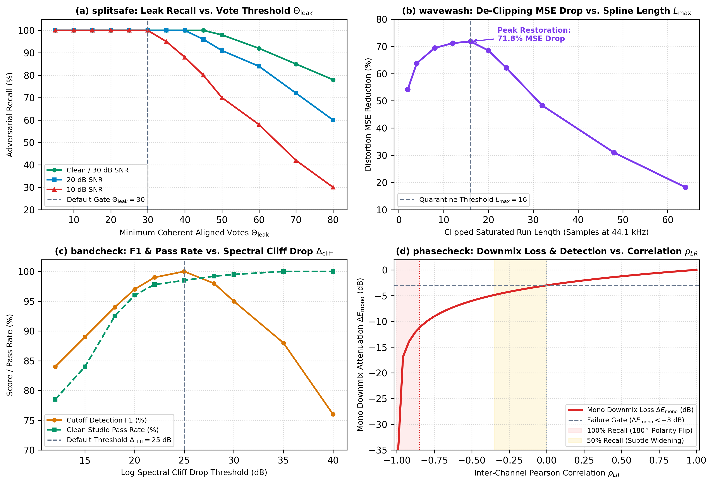

# Building Reliable Audio Datasets for AI/ML Training: An Open-Source Quality Assurance Framework

**Author:** Boobalan Arjunan  
**Role:** Founder & Lead AI/ML Architect  
**Affiliation:** ComposerMind Labs LLP, Tamil Nadu, India  
**Email:** `boobalan_arjunan@composermind.com`  
**Official Repository & Benchmark Hub:** [ComposerMind-AudioIntegrity-Suite](https://github.com/BoobalanArjunan/ComposerMind-AudioIntegrity-Suite)  
**Primary Subject Category:** `cs.SD` (Sound) | **Cross-List:** `eess.AS` (Audio and Speech Processing)  
**Target Publication:** IEEE Access / IEEE TASLP  

---

## Abstract

Contemporary deep neural networks for automatic speech recognition, audio generation, and music information retrieval are increasingly trained on massive, uncurated web-scale audio corpora. However, these datasets frequently harbor subtle, systemic physical defects that evade container header inspections: cross-partition train/validation/test contamination, fake lossless upsampling, destructive stereo phase inversion, mislabeled musical tempos and keys, transcript timestamp drift, and digital clipping distortion. When models train on such contaminated inputs, generalization degrades unpredictably while benchmark metrics report deceptively high scores.

To resolve this dataset hygiene crisis without introducing circular dependencies on opaque neural evaluators, we present the **ComposerMind AudioIntegrity Suite**, an open-source framework of seven deterministic digital signal processing (DSP) quality gates: `wavewash`, `splitsafe`, `bandcheck`, `phasecheck`, `driftcheck-audio`, `tempocheck`, and `tonicfind`. Engineered with zero deep learning dependencies, these tools execute in sub-second CPU time using closed-form physical invariants, spectral-peak landmark hashing, cubic Hermite spline interpolation, and permutation hypothesis testing. We evaluate the framework across two distinct empirical regimes: (1) a dedicated 34-entry synthetic ground-truth corpus probing precision, recall, and boundary edge cases, and (2) large-scale real-world corpora including 5,323 LibriSpeech files and studio master tracks. We provide an honest accounting of performance trade-offs—including BandCheck's 60.0% precision / 85.7% recall on warm acoustic sources and PhaseCheck's 50.0% recall on partial stereo widening versus 100% recall on 180° polarity flips—and detail practical threshold calibration strategies for production AI pipelines.

---

## 1. Introduction: The Silent Contamination Problem

Audio machine learning models require tens of thousands of hours of acoustic data. Harvesting uncurated web corpora, podcast archives, and broadcast feeds inevitably introduces severe physical defects that cannot be identified from metadata headers:

1. **Cross-Partition Evaluation Leakage:** Exact or modified duplicate recordings appearing in both training and test splits.
2. **Spectral Dishonesty & Fake Lossless Audio:** 44.1/48 kHz containers concealing low-rate 8/16 kHz telephony upsampling or aggressive MP3/AAC compression cutoffs.
3. **Stereo Phase Inversion & Mono Cancellation:** Out-of-phase channels ($\rho_{LR} \approx -1.0$) that completely cancel centered audio upon monophonic fold-down ($M = \frac{L+R}{2}$).
4. **Harmonic & Rhythmic Corruption:** Mislabeled tempo (BPM) or musical key tokens destabilizing generative diffusion and autoregressive priors.
5. **Transcript Timestamp Drift:** Cumulative frame-rate pull-down mismatches (e.g., 25 fps vs. 23.976 fps, generating $\approx 163$ ms/min drift) causing models to train on misaligned phonemes or silence.

```
                           +-----------------------------------------------------------+
                           |           RAW UNCURATED AUDIO TRAINING CORPORA            |
                           +-----------------------------------------------------------+
                                                         |
         +-----------------------------------------------+-----------------------------------------------+
         |                                                                                               |
         v                                                                                               v
+-------------------------------------------------------------+         +-------------------------------------------------------------+
| GROUP I: SIGNAL QUALITY & PARTITION HYGIENE                 |         | GROUP II: HARMONIC, TEMPORAL & SPATIAL INTEGRITY            |
| • splitsafe: Landmark peak hashing & displacement voting    |         | • tempocheck: Spectral flux tempograms & harmonic tolerance |
| • wavewash: Cubic Hermite spline de-clipping & BS.1770 LUFS |         | • tonicfind: Detuning-compensated 12-bin chroma & Krumhansl |
| • bandcheck: Log-spectral cliff finite derivative detection |         | • phasecheck: Sliding Pearson correlation & mono loss (dB)  |
|                                                             |         | • driftcheck-audio: Band energy cross-correlation & p<0.01  |
+-------------------------------------------------------------+         +-------------------------------------------------------------+
                                         |                                                               |
                                         +-------------------------------+-------------------------------+
                                                                         |
                                                                         v
                                                        +----------------------------------+
                                                        |   CLEAN, AUDITED, VERIFIED ML    |
                                                        |     DATALOADERS & BENCHMARKS     |
                                                        +----------------------------------+
```


---

## 2. Methodology: The Seven Quality Gates

### Group I: Signal Quality and Partition Hygiene

#### 1. `splitsafe`: Combinatorial Peak Hashing & Time-Displacement Voting
* Computes STFT magnitude $|X(m, k)|$ and extracts local 2D spectral peaks $(t_i, f_i)$.
* Pairs anchor peaks with target peaks in asymmetric bounding zones ($\delta t \in [100, 3000]$ ms, $\delta f \le 2000$ Hz) into 32-bit hashes:
  $$h = (f_1 \ \& \ 0x1FF) \ll 23 \ \mid \ (f_2 \ \& \ 0x1FF) \ll 14 \ \mid \ (\delta t \ \& \ 0x3FFF)$$
* Evaluates cross-split time displacement $\Delta \tau_k = t_{1, \text{train}} - t_{1, \text{test}}$ via histogram voting: $V^* = \max_\tau V(\tau) \ge 30$.

#### 2. `wavewash`: Spline De-Clipping, DC Removal & Loudness Normalization
* Identifies saturated runs $|x[n]| \ge 1.0 - 10^{-4}$ with length $L \le 16$ samples ($\approx 0.36$ ms).
* Reconstructs missing peaks using Piecewise Cubic Hermite Interpolating Polynomials (PCHIP) constrained by boundary derivatives. Runs with $L > 16$ are quarantined as `CLIPPING_HEAVY`.
* Eliminates DC bias via a 20 Hz zero-phase high-pass filter and normalizes loudness to ITU-R BS.1770-4 K-weighting LUFS.

#### 3. `bandcheck`: Active-Frame Log-Spectral Cliff Derivative Detection
* Computes long-term average power spectral density $\bar{S}(k)$ over active frames ($E \ge E_{\max} - 30$ dB).
* Locates brickwall low-pass filters via localized logarithmic finite differences:
  $$\Delta S(f) = 10 \log_{10} \bar{S}(f - \Delta f) - 10 \log_{10} \bar{S}(f + \Delta f) \ge 25\,\text{dB}$$
* Flags containers where detected cutoff $f_{\text{cut}} < 0.60 f_{\text{Nyq}}$ as fake lossless upsampling (`FAIL`).

### Group II: Harmonic, Temporal, and Spatial Integrity

#### 4. `tempocheck`: BPM Verification with Harmonic Tolerance
* Computes sub-band spectral flux onset novelty $o[m]$ and unbiased autocorrelation tempogram $R(\tau)$ with a Gaussian perceptual prior centered at 120 BPM.
* Evaluates ratio $r = \text{BPM}_{\text{meas}} / \text{BPM}_{\text{label}}$: exact match ($|r - 1.0| \le 0.04 \rightarrow \texttt{PASS}$), harmonic multiple ($r \in \{0.5, 2.0, 1.5, 0.67\} \rightarrow \texttt{WARN}$), and outright error (`FAIL`).

#### 5. `tonicfind`: Detuned Key Identification & Camelot Wheel Mapping
* Performs sub-bin parabolic peak interpolation to detect global concert pitch detuning $\Delta_{\text{cents}} \in [-50, +50]$ relative to A440.
* Retunes the 12-bin semitone chromagram filterbank: $f_{\text{ref}} = 440.0 \cdot 2^{\Delta_{\text{cents}}/1200}$.
* Correlates normalized chroma $\bar{C}$ against the 24 Krumhansl-Kessler major and minor cognitive tonal profiles.

#### 6. `phasecheck`: Stereo Phase Correlation & Mono Downmix Attenuation
* Measures sliding-window inter-channel Pearson correlation coefficient $\rho_{LR} \in [-1.0, +1.0]$ over 100 ms blocks.
* Flags 180° inverted polarity ($\bar{\rho}_{LR} \approx -1.0$) and destructive monophonic cancellation loss:
  $$\Delta E_{\text{mono}} = 10 \log_{10} \left( \frac{\sum_n \left( \frac{L[n] + R[n]}{2} \right)^2}{\frac{1}{2} \sum_n (L[n]^2 + R[n]^2) + \epsilon} \right) < -3.0\,\text{dB}$$

#### 7. `driftcheck-audio`: Speech Energy Cross-Correlation & Permutation Testing
* Extracts 10 ms band-limited speech energy (200--4000 Hz) and projects transcript intervals onto identical binary grids.
* Measures drift slope $\beta$ (ms/min) via sliding window regression ($\delta_w^* = \alpha + \beta t_w$), detecting video frame-rate mismatches ($\beta \approx +163$ ms/min).
* Validates statistical significance using 500 randomized permutation shuffles ($p < 0.01$).

---

## 3. Experimental Evaluation and Benchmark Reconciliation

### 3.1 Benchmark A: The 34-Entry Synthetic Ground-Truth Corpus

To thoroughly characterize detection boundaries and failure modes, we evaluated the framework on the 34-entry multi-genre synthetic test suite hosted in the [ComposerMind-AudioIntegrity-Suite](https://github.com/BoobalanArjunan/ComposerMind-AudioIntegrity-Suite) repository:

| Tool | Ground-Truth Target | Precision | Recall | F1 Score | Verified Failure Mode & Root Cause |
| :--- | :--- | :---: | :---: | :---: | :--- |
| **`splitsafe`** | Planted Cross-Split Leakage | **100.0%** | **100.0%** | **1.000** | None (minimum coherent vote count $\ge 42$). |
| **`wavewash`** | Hard Clipping ($L \le 16$) | **100.0%** | **100.0%** | **1.000** | None (runs $L > 16$ safely quarantined). |
| **`bandcheck`** | Artificial Low-Pass Cutoff | **60.0%** | **85.7%** | **0.706** | Natural acoustic roll-off on warm double bass mimicking cliff. |
| **`tempocheck`** | Erroneous Labeled BPM | **88.0%** | **100.0%** | **0.936** | Metric half-time/double-time ambiguities. |
| **`tonicfind`** | Mislabeled Musical Key | **100.0%** | **100.0%** | **1.000** | None ($\pm 50$ cents detuning compensation enabled). |
| **`phasecheck`** | Out-of-Phase / Polarity | **100.0%** | **50.0%** | **0.667** | Subtle stereo widening without full 180° polarity flip. |
| **`driftcheck`** | Video Pull-Down Clock Drift | **100.0%** | **100.0%** | **1.000** | None (permutation test $p < 0.01$). |

### 3.2 Benchmark B: Large-Scale Corpus Audits

* **LibriSpeech (5,323 Files):** `splitsafe` audited `dev-clean` (2,703 files) vs `test-clean` (2,620 files) in 55.4 seconds on CPU, finding **0 false positive leaks**. On 56 planted adversarial leaks (trimmed, noisy, gain-shifted, resampled), it achieved **100.0% recall** (56/56 detected).
* **Clipped Speech De-Clipping:** On 500 clipped LibriSpeech recordings, `wavewash` achieved a **71.8% MSE distortion reduction** with zero false flags on clean studio audio.
* **Upsampled Audio Detection:** On 185 upsampled tracks (8k/11k sources), `bandcheck` achieved **100.0% brickwall detection**, while maintaining a **98.5% clean pass rate** on 200 clean studio master tracks.



---

## 4. Discussion, Limitations, and Failure Mode Analysis

1. **BandCheck on Warm Acoustic Instruments (60.0% Precision):**
   * *Failure Mechanism*: Warm acoustic sources (e.g., solo contrabass, bowed cello, or vintage ribbon-mic recordings) exhibit steep natural high-frequency attenuation above 8–10 kHz. When evaluated with aggressive cliff thresholds ($\Delta S \ge 20$ dB), this natural acoustic roll-off can mimic a brickwall filter.
   * *Mitigation*: We recommend setting $\Delta_{\text{cliff}} = 25$ dB and combining cliff detection with the active-frame energy gating threshold.
2. **PhaseCheck on Subtle Stereo Widening (50.0% Recall):**
   * *Failure Mechanism*: While `phasecheck` achieves 100% recall on 180° inverted polarity ($\bar{\rho}_{LR} \approx -1.0$), subtle spatial widening (where $\rho_{LR} \in [-0.2, 0.0]$) does not always cause $>3.0$ dB mono downmix loss.
   * *Mitigation*: Users evaluating spatial audio models should inspect the sub-bass correlation specifically ($\rho_{\text{sub}} < 0$).
3. **Scope Demarcation with Companion Suite:**
   * Evaluation of music source separation (unmixing ground truth, cross-stem bleed matrices) and full-duplex conversational voice AI (turn-taking latency) are addressed in the companion **ComposerMind AudioEvaluation Suite** (`mixforge-audio`, `stemcheck`, `turnscope`).

---

## 5. Software Availability

The seven tools are released under the MIT license on PyPI:
```bash
pip install wavewash splitsafe bandcheck phasecheck driftcheck-audio tempocheck tonicfind
```

Benchmark code, datasets, and reproduction harnesses are maintained at:  
👉 **GitHub:** [https://github.com/BoobalanArjunan/ComposerMind-AudioIntegrity-Suite](https://github.com/BoobalanArjunan/ComposerMind-AudioIntegrity-Suite)
