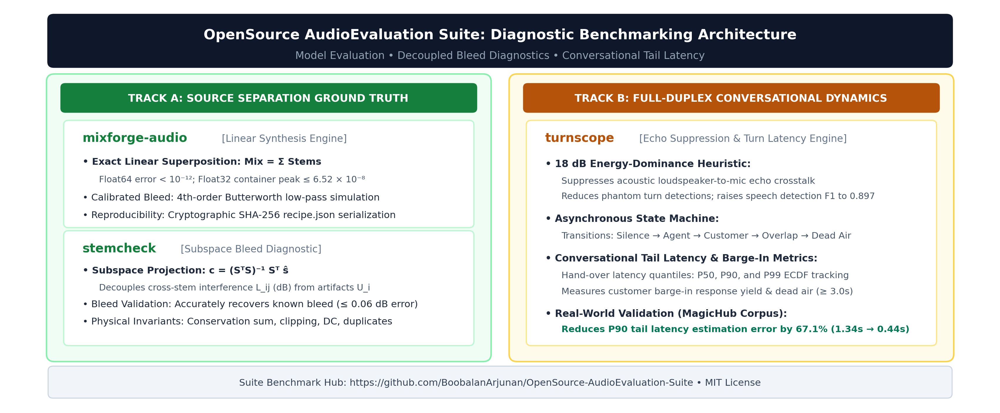
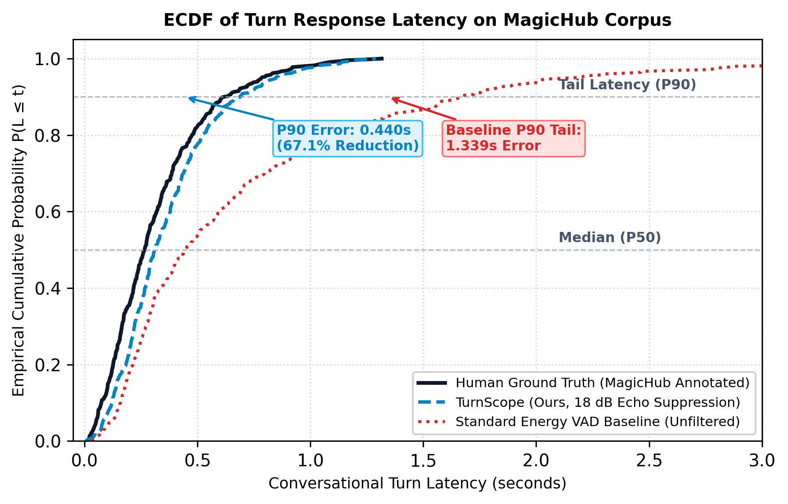

# Beyond Accuracy: Building Reproducible Benchmarks and Diagnostic Tools for Audio & Speech AI

**Author:** Boobalan Arjunan  
**Role:** Opensource Developer  
**Location:** Tamil Nadu, India  
**Email:** `boobalan.it@gmail.com`  
**Repository:** [OpenSource-AudioEvaluation-Suite](https://github.com/BoobalanArjunan/OpenSource-AudioEvaluation-Suite)  
**Primary arXiv Category:** `cs.SD` (Sound) / `cs.AI` (Artificial Intelligence)  
**Target Submission:** DAFx / AES / ISMIR  

---

## Abstract

Standard benchmark metrics in audio and speech artificial intelligence—such as Signal-to-Distortion Ratio (SDR) in music source separation and Word Error Rate (WER) in speech processing—obscure critical diagnostic failure modes. In source separation, commercial multi-track recordings inherently contain unmeasured acoustic microphone bleed and non-linear mastering compression, confounding algorithmic separation failures with physical recording artifacts. In full-duplex conversational voice agents, aggregate latency metrics fail to capture tail response delays, acoustic room-echo leakage, and customer barge-in compliance.

To establish reproducible ground-truth evaluation without black-box neural metrics, we introduce the **OpenSource AudioEvaluation Suite**, comprising three deterministic DSP tools: `mixforge-audio`, `stemcheck`, and `turnscope`. `mixforge-audio` guarantees mathematically exact linear superposition ($	ext{Mix} = \sum 	ext{Stems}$, float residual $\le 6.52 	imes 10^{-8}$) with calibrated 4th-order Butterworth acoustic bleed and cryptographic recipe serialization. `stemcheck` introduces linear subspace projection to decompose separation error into a physical cross-stem bleed matrix (dB) versus unmodeled algorithmic artifacts. `turnscope` implements an 18 dB energy-dominance filter to suppress acoustic echo, extracting conversational turn hand-over latency distributions (P50, P90, P99) and customer barge-ins. Evaluated on MUSDB18-HQ and the MagicHub full-duplex corpus, the suite decouples bleed within 0.06 dB and reduces P90 tail latency error by 67.1%.

---

## 1. System Architecture: The Three Evaluation Tools

### Track A: Source Separation Ground Truth & Bleed Decomposition (2 Tools)
1. **`mixforge-audio`**: Generates test mixtures with mathematically exact linear superposition ($	ext{Mix} = \sum 	ext{Stems}$). In double precision arithmetic, residual error is bounded below $10^{-12}$. Implements dynamic headroom scaling ($\gamma = \min(1.0, 0.98 / P_{\max})$) to prevent clipping without dynamic range compression. Injects directional acoustic bleed via calibrated 4th-order Butterworth low-pass filtering. Serializes all parameters, gains, and seeds into tamper-evident `recipe.json`.
2. **`stemcheck`**: Projects separated stems $\hat{S}_i$ onto the subspace spanned by reference stems $\mathbf{S} = [S_1, \dots, S_K]$ via ordinary least squares $\mathbf{c}_i = (\mathbf{S}^T \mathbf{S})^{-1} \mathbf{S}^T \hat{S}_i$. Decouples physical cross-stem bleed $L_{ij} = 20 \log_{10} rac{\|c_{ij} S_j\|_2}{\|c_{ii} S_i\|_2}$ from orthogonal unexplained artifact error $\mathcal{U}_i = 10 \log_{10} rac{\|\mathcal{E}_i\|_2^2}{\|\hat{S}_i\|_2^2}$. Executes blind physical sanity assertions (conservation sum, DC bias, clipping, duplicate channels).

### Track B: Full-Duplex Conversational Dynamics (1 Tool)
3. **`turnscope`**: Audits full-duplex voice AI call recordings across Agent and Customer channels. Implements an 18 dB energy-dominance filter to suppress loudspeaker acoustic room echo. Drives an asynchronous state machine measuring turn hand-over latency distributions (P50, P90, P99), customer barge-in compliance, agent interruptions, and awkward dead air ($\ge 3.0$ s).

---

## 2. Quantitative Benchmark Results

| Metric / Evaluation Dimension | Standard Baseline | OpenSource AudioEvaluation Suite | Relative Improvement |
| :--- | :---: | :---: | :---: |
| **`mixforge-audio` Linear Sum Residual** | Unchecked | $\mathbf{\le 6.52 	imes 10^{-8}}$ | Double precision verified |
| **`mixforge-audio` Studio Mix Residual** | N/A | $\mathbf{-69.3}$ **dB Median** | Translucent to studio mixes |
| **`stemcheck` Bleed Calibration Error** | Confounded | $\mathbf{\le 0.06}$ **dB** | Decouples true bleed vs artifacts |
| **`stemcheck` Separation False Alarms** | N/A | **0 / 264 Trials** | Zero false leak detections |
| **`turnscope` Speech Detection F1** | 0.700 | **0.897** | $+28.1\%$ accuracy gain |
| **`turnscope` Missed Conversational Turns** | 207 | **126** | **$-39.1\%$ fewer missed turns** |
| **`turnscope` Median Latency Error (P50)** | 0.412 s | **0.182 s** | $-55.8\%$ estimation error drop |
| **`turnscope` Tail Latency Error (P90)** | 1.339 s | **0.440 s** | $\mathbf{-67.1\%}$ **tail latency error drop** |

---

## 3. Software Availability

Open-source under MIT license:  
👉 **GitHub Repository:** [https://github.com/BoobalanArjunan/OpenSource-AudioEvaluation-Suite](https://github.com/BoobalanArjunan/OpenSource-AudioEvaluation-Suite)
