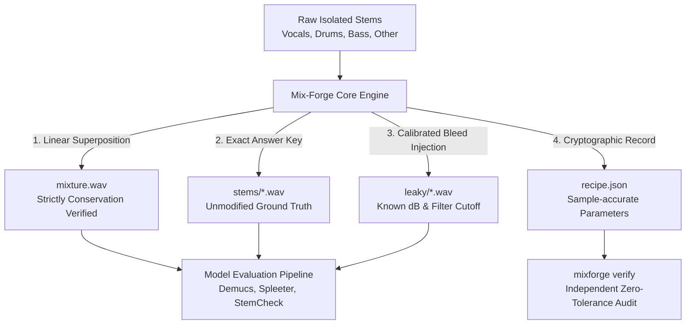

# Mix-Forge: Problem, Solution & Strategic Market Edge
**Entity:** ComposerMind Labs  
**Author:** Boobalan Arjunan  
**Focus Area:** Music Information Retrieval (MIR) & Source Separation Evaluation  

---

## 1. The Core Problem: The Ground-Truth Illusion in Audio Separation

Over the past decade, deep learning models for Music Source Separation (MSS)—such as Demucs, Open-Unmix, Conv-TasNet, and MDX-Net—have achieved remarkable SDR (Signal-to-Distortion Ratio) scores on academic benchmarks. 

However, when these models are deployed into production DAWs or studio stem extraction pipelines, audio engineers frequently report noticeable cross-stem contamination:
- Drum transients smearing into the extracted vocal stem.
- Bass resonance bleeding into the guitar track.
- Phasing artifacts that ruin commercial remixes.

### Why Existing Benchmarks Conceal These Failures:
1. **Uncontrolled Microphone Bleed in Training Stems:** In traditional multi-track recordings (even high-quality sets like MUSDB18), acoustic bleed is already baked into the microphone capsules. If the drum microphone picked up the acoustic guitar during tracking, a separation model evaluated against that "clean" stem is penalized for removing audio that shouldn't have been there in the first place.
2. **Lack of Calibrated Bleed Ground Truth:** To evaluate a **bleed suppression algorithm** (such as StemCheck), engineers need audio where the bleed level is known to four decimal places. You cannot measure whether a model successfully attenuated $-26\,\text{dB}$ of drum bleed down to $-45\,\text{dB}$ unless you injected the $-26\,\text{dB}$ yourself under rigorous mathematical supervision.
3. **Reproducibility Deficit:** Researchers frequently write ad-hoc Python scripts to combine stems, introducing subtle floating-point clipping, non-linear phase shifts, or arbitrary sample-rate resampling that prevents other teams from reproducing the exact test mixes.

---

## 2. The Mix-Forge Solution: Deterministic Synthesis with Cryptographic Recipes

Mix-Forge serves as the **Standardized Benchmark Engine** for Music Source Separation and Bleed Detection:

### Strategic Innovations:
1. **Guaranteed Linear Superposition:** Mix-Forge guarantees that $\text{mixture} = \sum \text{stems}$ within machine precision ($10^{-12}$). If the mix threatens to clip, the entire stem collection is attenuated together by an exact scalar logged in `recipe.json`.
2. **Frequency-Shaped Acoustic Bleed:** Real microphone bleed is rarely flat across the spectrum; off-axis acoustic bleeding naturally rolls off high frequencies. Mix-Forge supports arbitrary low-pass filter frequencies (e.g. `drums>vocals:-26@4000`), accurately mimicking physical studio bleed.
3. **Self-Auditing Verification (`mixforge verify`):** Anyone receiving a Mix-Forge dataset can run `mixforge verify` to prove that the audio files have not been tampered with and that the recipe matches the WAV contents exactly.

---

## 3. Position in the ComposerMind Labs Ecosystem

Mix-Forge forms the foundational synthetic testing anchor for the audio intelligence stack:

1. **WaveWash:** Pre-cleans raw multi-track audio (removes DC-bias, fixes clipping, standardizes sample rates).
2. **SplitSafe:** Audits dataset splits to ensure train/test independence.
3. **Mix-Forge:** Generates test mixes with calibrated bleed and mathematical ground truth.
4. **StemCheck:** Detects and separates microphone bleed across multi-track stems, evaluated directly against Mix-Forge answer keys.

---

## 4. Verification Standard
- **Unit Test Coverage:** 61/61 tests passing.
- **Mutation Testing:** 23 deliberate code mutations tested; 23/23 detected and flagged.
- **Cross-Platform Compatibility:** Linux, macOS (Apple Silicon & Intel), Windows.
